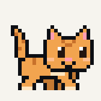
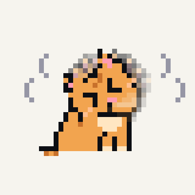
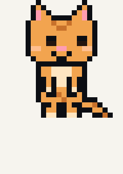

# perchcat

一只住在 macOS 桌面上的像素橘猫。它会走路、睡觉、在窗口之间跳，还能跨屏幕。

A pixel cat for your Mac desktop. It walks, naps, and jumps between windows and screens.



被拖走窗口惊醒时会甩干，向上拎久了会坠成一条猫：

 

## 它会做什么

- 把窗口顶边当平台：窗口被拖走，猫就掉下来。醒着的猫会跟着窗口走。
- 多屏幕之间跳跃，Dock 所在屏幕和全屏窗口都会调整地板高度。
- 点一下或按住轻蹭是摸头；向上拖是拎起来，松手可以甩出去。
- 菜单栏图标：显示/隐藏、开机自启（可随时关闭）、退出。不占 Dock。

只读取窗口的位置、层级和所属进程，不读标题或内容，不需要屏幕录制权限。

## 安装

需要 macOS 和 Swift 工具链（Xcode 或 Command Line Tools）。

```sh
./scripts/install.sh      # 构建并安装到 ~/Applications/perchcat
~/Applications/perchcat
```

## 换皮肤

内置素材由 `scripts/build_assets.py` 生成。自定义皮肤是一份 JSON：`{"palette": {"K": "#000000"}, "poses": {"stand": ["...", "..."]}}`，所有姿势尺寸相同。

按下面的顺序查找：`--skin 路径`、环境变量 `PERCHCAT_SKIN`、`~/Library/Application Support/perchcat/pet-skin.json`，都没有就用内置橘猫。

其他参数：`--scale 4`、`--sleep-chance 0.55`。

## 开发

```sh
swift test
```

只有 Command Line Tools 时，`swift test` 可能要额外指定 Testing 框架的路径。

## 许可

代码和内置橘猫素材都使用 [MIT](LICENSE)。
